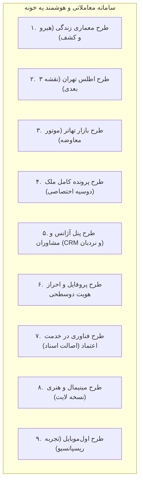

# سند جامع الزامات محصول و راهنمای الهام‌بخش طراحی رابط و تجربه کاربری (UI/UX Design Specification & Visual Blueprint)
## سامانه هوشمند املاک، نقشه کاداستر و تالار تخصصی تهاتر «یه خونه» (YeKhoone)

> [!NOTE]
> این سند بر اساس تصاویر مرجع و کانسپت‌های نه‌گانه طراحی برند **«یه خونه»** تدوین شده است تا طراح UI/UX دقیقاً بداند چه ساختار بصری، ترکیب‌بندی، پالت‌های رنگی و ماژول‌هایی باید در Figma پیاده‌سازی شوند.

---

## ۱. بُرد الهام‌بخش بصری (Visual Inspiration Board)

````carousel

<!-- slide -->

````

---

## ۲. ارکان هویت بصری و فلسفه طراحی (Visual Pillars)

بر اساس تصاویر مرجع، هویت بصری «یه خونه» بر پایه سه اصل استوار است:

1. **ترکیب عکاسی سینمایی و مینیمالیسم معمارانه:**  
   تصویر پس‌زمینه هدر تلفیقی از خط آسمان تهران (برج میلاد و کوه‌های البرز) در غروب/شامگاه همراه با معماری ویلاهای مدرن است. این ترکیب حس آرامش، اعتبار بالا و لوکس بودن را به کاربر منتقل می‌کند.
2. **کارت شناور نقشه در هیرو (Floating Map Widget):**  
   در سمت چپ هدر (یا هیرو)، یک ویجت گلس‌مورفیک شناور و مدرن با عنوان **«نقشه هوشمند تهران»** قرار می‌گیرد که پیش‌نمایشی درخشان از بافت شهری و پلاک‌ها را نمایش داده و کاربر را با یک کلیک به اطلس سه‌بعدی هدایت می‌کند.
3. **کپسول جستجوی یکپارچه و آیکون‌های خطی دسته‌بندی:**  
   - ردیف اول: تب‌های تفکیک معامله `[ خرید و فروش | رهن و اجاره | تهاتر ]`
   - ردیف دوم: نوار سرچ تمیز شامل فیلد جستجوی محله/پلاک + انتخاب شهر [تهران] + دکمه گرادیان جستجو
   - ردیف سوم: چیپ‌های دسته‌بندی با آیکون‌های مینی‌مال خطی:
     - `🏢 آپارتمان مسکونی`
     - `🏡 ویلا و عمارت`
     - `📐 زمین و موقعیت ساخت`
     - `🌳 باغ و باغچه`
     - `🏗️ کلنگی و تجمیع`

---

## ۳. نقشه ماژول‌های نه‌گانه پلتفرم (The 9 Core Modules)



### ۱. طرح «معماری زندگی» (هیرو و صفحه اصلی)
* **ترکیب‌بندی:** تصویر وسیع و الهام‌بخش از پایتخت + کپسول جستجوی مرکزی + ویجت نقشه شناور.
* **تیتر اصلی:** *«فراتر از یک جست‌وجو / یک نقشه از فرصت‌ها»* یا *«ملک خوب، فرصت خوب»*.
* **شمارنده‌های اعتماد (Social Proof Stats):**
  - `+۵,۰۰۰` فایل ملکی معتبر
  - `+۳,۰۰۰` کاربر فعال
  - `+۱,۲۰۰` معامله موفق

---

### ۲. طرح «اطلس تهران» (نقشه هوشمند پلاک‌به‌پلاک - `/map`)
* **ترکیب‌بندی:** نقشه تعاملی تمام‌صفحه با لایه وکتور دارک، نمایش مرز مناطق ۲۲ گانه تهران.
* **پین‌های سه‌بعدی املاک:** نمایش عکس شاخص، عنوان و قیمت روی پلاک ثبتی.
* **درآور کشویی طبقات و واحدها (Building Dossier Drawer):** باز شدن مشخصات پلاک، سال ساخت، تعداد واحدها و لیست واحدهای آماده واگذاری در طبقات مختلف.

---

### ۳. طرح «بازار تهاتر» (موتور اختصاصی معاوضه و سرک نقدی - `/barter`)
* **ترکیب‌بندی دو ستونه مقایسه‌ای (Dual Comparison Stage):**
  - **ستون راست (دارایی اول):** مشخصات ملک عرضه‌شده (مثلاً زمین کلنگی در نیاوران به ارزش ۱۳۵ میلیارد تومان).
  - **المان اتصال مرکزی:** دکمه سوآپ چرخان `⇄` با محاسبه‌گر اتوماتیک اختلاف ارزش نقدی (Cash Delta).
  - **ستون چپ (دارایی متناظر):** مشخصات آپارتمان‌ها یا خودروهای پیشنهادی برای معاوضه + مبلغ مابه‌التفاوت نقدی.
* **انواع قراردادهای تهاتر:**
  - تهاتر سر به سر (ملک با ملک هم‌ارزش)
  - تهاتر با آپارتمان نوساز + نقدینگی
  - تهاتر ملک با خودروهای وارداتی پلاک ملی

---

### ۴. طرح «پرونده کامل ملک» (Dossier - `/property/[id]`)
* **ترکیب‌بندی چندرسانه‌ای:**
  - ناوبری میان گالری عکس، ویدیوی تور 4K، و **تور مجازی ۳۶۰ درجه تعاملی** (همراه با نقاط داغ مشخصات متریال و پرتال‌های تغییر فضا).
* **جدول مشخصات کاداستری:** متراژ عرصه و اعیان، عرض گذر، طول بر، تراکم مصوب R122، و وضعیت تاییدیه سند تک‌برگ شخصی.
* **کارت چسبان مشاور و مالی:** قیمت کل، ارزش متری، هویت مشاور رسمی پرونده و دکمه‌های تماس مستقیم و درخواست نشست.

---

### ۵. طرح «پنل آژانس و مشاوران» (Agency Dashboard - `/agency/dashboard`)
* **ناوبری سایدبار عمودی:** خانه، نقشه تهران، بازار تهاتر، فایل‌های من، آژانس‌ها، تنظیمات.
* **میز کار تحلیلی:**
  - نمودار روند تغییرات قیمت متری در مناطق تحت پوشش (Area Trend Chart).
  - جدول مانیتورینگ فایل‌ها با قابلیت فیلتر بر اساس وضعیت معامله.
  - **نردبان هوشمند الگوریتمی:** نمایش زمان باقی‌مانده تا رفرش ارگانیک فایل در صفحه اول.

---

### ۶. طرح «پروفایل کاربری و احراز هویت» (Auth & Profile - `/profile`)
* **ثبت‌نام دو مرحله‌ای:** نام و تماس + چالش ریاضی هوشمند ضدربات.
* **فرم گزینش رسته کاربری:**
  - کارت ۱: **متقاضی مسکن** (خرید، رهن، یا متقاضی تهاتر)
  - کارت ۲: **مالک مسکن** (ثبت کد ملی و پلاک، فعال‌سازی گزینه تمایل به تهاتر)
  - کارت ۳: **مشاور املاک** (کد صنفی پروانه، اتصال به دفتر املاک)
  - کارت ۴: **مدیر آژانس** (پروانه کسب، مدیریت مشاوران)

---

### ۷. طرح «فناوری در خدمت اعتماد» (Trust Engine)
* المان‌های سنجش اصالت: تاییدیه استعلام ثبت اسناد، تاییدیه پهنه‌بندی شهرداری، نشان اصالت مشاوران معتبر.

---

### ۸. طرح «مینیمال و هنری» (نسخه لایت - Light Mode)
* پالت معمارانه گالری سفید (`#f8fafc` و `#ffffff`) با فونت‌های زغالی، کنتراست خطوط خاکستری و حس آرامش روزانه.

---

### ۹. طرح «اول‌موبایل» (Mobile-First Ergonomics)
* بازطراحی تمامی کامپوننت‌ها به صورت تک‌ستونه ارگونومیک، منوی ناوبری چسبان پایینی (Bottom App Bar)، و اکشن‌های لمسی سریع برای کاربران گوشی‌های هوشمند.

---

## ۴. مشخصات دیزاین سیستم برای فیگما (Figma Design Tokens)

### ۴.۱. توکن‌های رنگی کانسپت‌ها

| عنصر رابط کاربری | کانسپت شب / تایتانیوم (کد ۱ و ۳) | کانسپت روز / گالری (کد ۲ و ۸) | کانسپت داشبورد معاملاتی |
| :--- | :--- | :--- | :--- |
| **Canvas Background** | `#0a0f18` (دودی شبانه) | `#f8fafc` (سفید چینی) | `#070b12` (آبسیدین تیره) |
| **Surface Cards** | `#111927` با حاشیه مویی | `#ffffff` با حاشیه ۱ پیکسلی | `#0e1624` با لاین‌های ظریف |
| **Accent Primary** | `#f59e0b` (طلایی کهربایی) | `#d97706` (کهربایی کلاسیک) | `#eab308` (طلایی درخشان) |
| **Barter Accent** | `#38bdf8` (آبی فیروزه‌ای تهاتر) | `#0284c7` (آبی سرمه‌ای تهاتر) | `#06b6d4` (فیروزه‌ای نئون) |
| **Headings & Body** | `#f8fafc` / `#cbd5e1` | `#0f172a` / `#475569` | `#f1f5f9` / `#94a3b8` |

### ۴.۲. تایپوگرافی و نمادها
- استفاده از فونت **وزیرمتن (Vazirmatn)** یا **ایران‌یکان (IRANYekan)** در اوزان Regular (400)، SemiBold (600) و ExtraBold (800).
- فعال‌سازی اعداد فارسی متناسب با واحد پول تومان (`font-feature-settings: "ss01"`).
- انحنای گوشه‌ها: اکیداً **8px** برای المان‌های درون‌صفحه‌ای و **16px** برای کارت‌ها و کپسول‌های شناور.
